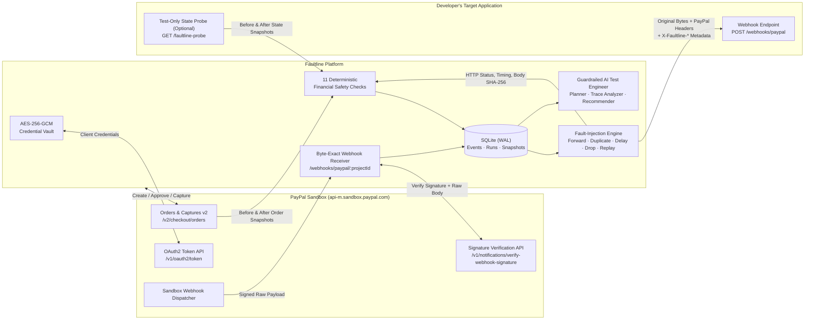

# FAULTLINE

**Payment Reliability & Webhook Chaos Engineering Platform for PayPal Sandbox**

[](https://nodejs.org/)
[](https://developer.paypal.com/api/rest/)
[](https://www.sqlite.org/)
[](#testing--verification)

> *"Don't just test whether your payment works. Test whether it survives failure."*

---

## The Problem

Most developers test payment integrations on the happy path: create an order, approve it in the sandbox, receive one webhook, and verify that the database updates.

In production, payment systems are distributed and asynchronous:
- **Duplicate deliveries**: Payment providers use at-least-once delivery. Network blips or slow acknowledgements trigger automatic retries of the same webhook.
- **Concurrent races**: Two copies of `PAYMENT.CAPTURE.COMPLETED` arriving milliseconds apart can bypass naive `SELECT`-then-`INSERT` checks and credit an account twice.
- **Out-of-order arrival**: A delayed `CHECKOUT.ORDER.APPROVED` webhook arriving *after* `PAYMENT.CAPTURE.COMPLETED` can regress a paid order back to an uncaptured state.
- **Partial transaction failures**: A webhook handler that commits a database write before throwing an HTTP `500` invites a provider retry that double-processes the payment.
- **Dropped notifications**: If a webhook is lost in transit and the application never reconciles against the provider's API, paid orders remain stuck forever.

**Faultline** makes these abnormal delivery conditions testable, observable, and deterministic against real **PayPal Sandbox** transactions.

---

## System Architecture



---

## Key Capabilities

### 1. Genuine PayPal Sandbox Integration
- **Live Credential Validation**: Authenticates directly against `https://api-m.sandbox.paypal.com/v1/oauth2/token`. Invalid credentials or unreachable endpoints are reported with PayPal's exact error code and `paypal-debug-id`.
- **End-to-End Sandbox Checkout Flow**: Creates real Sandbox orders (`POST /v2/checkout/orders`), links to PayPal's buyer approval flow, syncs order status (`GET /v2/checkout/orders/{id}`), captures approved payments (`POST /v2/checkout/orders/{id}/capture`), and inspects capture details (`GET /v2/payments/captures/{id}`).
- **Cryptographic Webhook Verification**: Preserves every incoming webhook payload **byte-for-byte** (never re-serialized) and verifies authenticity via PayPal's `POST /v1/notifications/verify-webhook-signature` API. Unverified or forged payloads are never labeled as verified and cannot be forwarded.

### 2. Byte-Exact Webhook Fault Injection (Test Lab)
Select any PayPal-verified webhook event and execute controlled delivery scenarios against your application's webhook endpoint:

| Scenario | What Faultline Does | Failure Mode Tested |
|---|---|---|
| **Forward Once** (`forward`) | Sends the stored verified event once, byte-for-byte. | Baseline webhook signature verification and processing. |
| **Duplicate Delivery** (`duplicate`) | Sends the same verified event **2 to 10 times**, either **sequentially** or **concurrently** (all at once). | Idempotency keys, unique constraints, and race conditions under parallel redelivery. |
| **Delayed Delivery** (`delay`) | Holds the received event and forwards it after a configurable delay (**1 to 3,600 seconds**). | Out-of-order webhook arrival, stale-event state regression, and timestamp tolerance. |
| **Dropped Delivery** (`drop`) | Intentionally withholds the webhook (`0` HTTP requests sent) and records the drop. | Missing-webhook resilience and reconciliation via PayPal's Orders/Captures API. |
| **Replay Delivery** (`replay`) | Resends a previously processed verified event at a later time. | Long-horizon deduplication and protection against duplicate payment creation. |

Every forwarded attempt preserves the original raw JSON bytes and PayPal signature headers (`paypal-transmission-id`, `paypal-transmission-time`, `paypal-transmission-sig`, `paypal-cert-url`, `paypal-auth-algo`) so your application performs its normal signature check, while adding explicit `X-Faultline-*` observability headers:

| Header | Example Value | Purpose |
|---|---|---|
| `X-Faultline-Scenario` | `duplicate` | Active scenario (`forward`, `duplicate`, `delay`, `replay`) |
| `X-Faultline-Delivery-Kind` | `duplicate` | Attempt classification (`original`, `duplicate`, `delayed`, `replay`) |
| `X-Faultline-Attempt` | `2/3` | Attempt index within the scenario run |
| `X-Faultline-Injected` | `true` | `false` only for a baseline single delivery; `true` for fault-injected attempts |
| `X-Faultline-Original-Event-Id` | `WH-2WR32451HC0233532-...` | Original PayPal event ID |
| `X-Faultline-Original-Received-At` | `2026-11-07T14:20:05.112Z` | Timestamp when Faultline first received the event from PayPal |
| `X-Faultline-Run-Id` | `d4f8c9b0-...` | Faultline scenario run UUID |

### 3. Deterministic Financial Safety Invariants
An HTTP `200 OK` response only proves that an HTTP server answered—it does not prove that your application handled the payment safely. Faultline evaluates **11 deterministic checks** across three explicit evidence sources:
1. **Observed (`observed`)**: Faultline's own HTTP delivery trace, status codes, timings, and SHA-256 payload digests.
2. **PayPal (`paypal`)**: Verified PayPal webhook payloads and PayPal Order/Capture snapshots read before and after the run.
3. **Application State Probe (`probe`)**: An optional test-only `GET` endpoint in your application that Faultline queries before and after each scenario run.

| Deterministic Check | Evidence | Pass Criterion |
|---|---|---|
| **Faultline sent the genuine event unchanged** (`injection_integrity`) | Observed | Every request carried the exact SHA-256 body and PayPal transmission ID of the stored event. |
| **Your endpoint accepted every delivery** (`deliveries_accepted`) | Observed | Every forwarded request received an HTTP `2xx` response. |
| **A failed delivery is not reported as processed** (`failed_delivery_not_processed`) | Probe | When all deliveries fail, `event.processed_count` does not increase. |
| **An accepted delivery was actually processed** (`accepted_delivery_processed`) | Probe | After at least one HTTP `2xx` delivery, `event.processed_count >= 1`. |
| **The same event is processed at most once** (`idempotent_processing`) | Probe | Across duplicate or replayed deliveries, `event.processed_count` never exceeds `1`. |
| **A repeated webhook does not create a second payment record** (`no_second_payment_in_app`) | Probe | `payment.payment_records` never exceeds `1` for the same capture or order. |
| **No new capture appeared at PayPal during the test** (`paypal_payment_unchanged`) | PayPal | Capture count on the linked PayPal Sandbox order did not increase during the webhook test. |
| **Refunds reported by PayPal do not exceed the captured amount** (`refund_events_within_captured`) | PayPal | Verified `PAYMENT.CAPTURE.REFUNDED` events do not sum to more than the captured amount. |
| **Refunds in your application do not exceed the captured amount** (`app_refunds_within_captured`) | Probe | `payment.refunded_amount <= payment.captured_amount`. |
| **A late, older event does not overwrite newer payment state** (`no_stale_overwrite`) | Probe | Delivering an older event after a newer event for the same payment never moves `payment.status` backward. |
| **The payment only makes valid state changes** (`valid_state_transition`) | Probe | `payment.status` stays unchanged or makes a valid PayPal lifecycle transition. |

**Strict Verdict Rules:**
- **Failed**: At least one deterministic check failed.
- **Passed**: Zero checks failed **and** at least one application-state (`probe`) check passed.
- **Inconclusive**: Zero checks failed, but no application-state check could be evaluated (e.g., no state probe configured). HTTP `2xx` replies alone never produce a `Passed` verdict.

### 4. Guardrailed AI Test Engineer
The AI Test Engineer accelerates reliability testing without compromising deterministic rigor:
- **Natural-Language Test Planning**: Converts plain-English requests (e.g., *"Test whether my application processes the same completed payment webhook twice"*) into a **validated structured test specification** mapped to Faultline's deterministic assertions and stored verified events.
- **Evidence-Based Failure Analysis**: Inspects completed or failed execution traces (HTTP status sequences such as `500` on first delivery followed by `200` on retry, probe deltas before/after, and failed assertions) to explain *what happened*, *what was expected*, *where the failure occurred*, *why it matters*, and *how to remediate it*—strictly separating **Directly Observed Facts**, **Assumptions & Blind Spots**, and **Recommendations**.
- **Integration-Specific Test Suggestions**: Analyzes your project's stored verified events, run history, and unevaluated checks to recommend concrete next tests (such as concurrent duplicate races or stale-overwrite delay tests).
- **Hard Code-Level Guardrails**:
  - Cannot fabricate PayPal events or execute scenarios on unverified payloads.
  - Cannot execute financial operations (`financialOperationsAllowed: false` enforced in `validateTestSpec`).
  - Cannot invent results or override deterministic verdicts (`enforceAnalysisGuardrails` locks `deterministicVerdict.canOverride = false`).
  - Has zero access to PayPal secrets, OAuth tokens, encryption keys, or session secrets.

---

## Quickstart & 3-Minute Demo

### Prerequisites
- **Node.js 22 LTS** (Node.js `>=20` supported)
- **Windows Command Prompt (`cmd.exe`)** (or any standard terminal)
- A free [PayPal Developer](https://developer.paypal.com) account (for live Sandbox calls)

### 1. Install & Initialize
```cmd
git clone https://github.com/NOBA235/faultline.git
cd faultline
npm install
npm run setup
npm start
```
- `npm run setup` generates `.env` with cryptographically random `ENCRYPTION_KEY`, `SESSION_SECRET`, and `ADMIN_PASSWORD` values and prints your sign-in password to the console.
- Open **http://127.0.0.1:3000** and sign in with the printed `ADMIN_PASSWORD`.

### 2. Run the Interactive Fault-Injection Demo
Faultline ships with a standalone demo receiver and state probe (`scripts/demo-receiver.js`) that can run in **`buggy`** mode (non-idempotent, vulnerable to duplicate processing and stale overwrites) or **`idempotent`** mode (properly guarded):

1. **Start the demo receiver in `buggy` mode** (in a second terminal):
   ```cmd
   npm run demo-receiver
   ```
   *(Or explicitly: `node scripts\demo-receiver.js buggy` — listens on `http://127.0.0.1:4000`)*
2. **Create a Project in Faultline**:
   - **Sandbox Client ID & Secret**: From your [PayPal Developer Dashboard](https://developer.paypal.com/dashboard/applications/sandbox)
   - **Webhook Endpoint URL**: `http://127.0.0.1:4000/webhooks/paypal`
   - **State Probe URL**: `http://127.0.0.1:4000/faultline-probe`
3. **Receive a Verified PayPal Webhook**:
   - Expose port `3000` via an HTTPS tunnel (e.g., `ngrok http 3000`), set `PUBLIC_BASE_URL=https://<your-tunnel>` in `.env`, register the project's **Receiver URL** in your PayPal Sandbox App's Webhooks settings, save the **PayPal Webhook ID** in Faultline, and create/approve/capture a Sandbox order.
4. **Watch Faultline Catch the Bug**:
   - Open **AI Test Engineer**, enter:
     > `Test whether my application processes the same completed payment webhook twice.`
   - Click **Generate test plan**, then **Execute validated test plan**.
   - **Result**: Faultline marks the run **Failed**—showing that although your endpoint returned `HTTP 200` on both deliveries, `event.processed_count` and `payment.payment_records` both climbed to `2`.
   - Click **Analyze with AI Test Engineer** to view the evidence-backed root-cause breakdown and remediation guidance.
5. **Verify the Fix**:
   - Restart the demo receiver in `idempotent` mode:
     ```cmd
     node scripts\demo-receiver.js idempotent
     ```
   - Re-run the scenario in Faultline and watch all deterministic application-state checks **Pass**.

---

## Application State Probe Contract

To let Faultline verify internal financial invariants without coupling to your database engine, expose a test-only `GET` endpoint in your staging/test environment:

```http
GET <probe_url>?event_id=WH-...&resource_id=...&event_type=PAYMENT.CAPTURE.COMPLETED
```

```json
{
  "event": {
    "processed_count": 1
  },
  "payment": {
    "status": "COMPLETED",
    "captured_amount": "10.10",
    "refunded_amount": "0.00",
    "currency": "USD",
    "payment_records": 1
  }
}
```

```javascript
// Minimal Express example (enable in TEST / STAGING environments only)
app.get('/faultline-probe', async (req, res) => {
  const seen = await db.get(
    'SELECT COUNT(*) AS n FROM processed_webhooks WHERE paypal_event_id = ?',
    req.query.event_id
  );
  const pay = await db.get(
    'SELECT status, captured, refunded, currency FROM payments WHERE capture_id = ?',
    req.query.resource_id
  );
  const records = await db.get(
    'SELECT COUNT(*) AS n FROM payments WHERE capture_id = ?',
    req.query.resource_id
  );
  res.json({
    event: { processed_count: seen.n },
    payment: pay ? {
      status: pay.status,
      captured_amount: pay.captured,
      refunded_amount: pay.refunded,
      currency: pay.currency,
      payment_records: records.n,
    } : {},
  });
});
```

---

## Security & Engineering Design

- **Envelope Encryption at Rest**: PayPal Sandbox secrets are encrypted using **AES-256-GCM** (`src/crypto.js`) with a 96-bit random IV, 128-bit authentication tag, and the project UUID bound as Additional Authenticated Data (AAD). Secrets are never returned by any API endpoint, never written to logs, and never stored in browser storage.
- **Session & Origin Hardening**: `HttpOnly`, `SameSite=Strict`, HMAC-SHA256 signed session cookies with IP rate limiting on login, strict `Content-Security-Policy`, and cross-origin write rejection.
- **Loop & Redirect Protection**: Forwarder and state probe requests block self-referential loops to Faultline's own receiver, refuse to follow HTTP `3xx` redirects, enforce strict request timeouts (`FORWARD_TIMEOUT_MS`), and cap response body reads.

---

## Testing & Verification

Run the full automated test suite (**131 tests** across 13 test files):

```cmd
npm test
```

| Test Suite | Coverage |
|---|---|
| `test/paypal.test.js` & `test/orders.test.js` | OAuth2 token exchange, Order creation/refresh/capture, idempotency locks, and error handling |
| `test/webhooks.test.js` | Byte-exact webhook ingestion, PayPal signature verification states, redelivery deduplication, and forgery rejection |
| `test/scenarios.test.js` | Baseline forwarding, sequential & concurrent duplicates, delayed delivery timers, deliberate drops, and replays |
| `test/checks.test.js` & `test/checks-integration.test.js` | All 11 deterministic financial safety checks against idempotent and planted-bug target applications |
| `test/ai-engineer.test.js` & `test/ai-integration.test.js` | Natural-language test planning, spec validation, execution-trace failure analysis, test suggestions, and AI safety guardrails |
| `test/reports.test.js` | Overview metrics accuracy, reliability findings, failed assertions, and Markdown/JSON report exports |
| `test/api.test.js`, `test/crypto.test.js`, `test/config.test.js`, `test/db.test.js` | Authentication, AES-256-GCM tamper detection, configuration validation, and SQLite schema migrations |

### Transparent Disclosure on Test Environments
- **Automated Fixture Tests (`[fixture]`)**: Automated tests in `test/` use controllable local HTTP stand-in servers (`support/fixtures.js`) for PayPal and the target application so the suite runs deterministically offline.
- **Live PayPal Sandbox Operations**: Connecting to the live `https://api-m.sandbox.paypal.com` APIs and receiving live PayPal webhooks requires your own PayPal Sandbox `Client ID`, `Secret`, `Webhook ID`, and an HTTPS tunnel for inbound webhook delivery.

---

## Environment Variables

| Variable | Required | Default | Description |
|---|---|---|---|
| `ENCRYPTION_KEY` | Yes | — | 64 hex characters (32 bytes). Master key for AES-256-GCM encryption of PayPal secrets. |
| `SESSION_SECRET` | Yes | — | At least 32 characters. Signs the `HttpOnly` session cookie. |
| `ADMIN_PASSWORD` | Yes | — | At least 12 characters. Password for signing in to the Faultline UI. |
| `PORT` | No | `3000` | HTTP server port (`1`–`65535`). |
| `HOST` | No | `127.0.0.1` | Bind address. |
| `DATABASE_PATH` | No | `data/faultline.db` | Path to the SQLite database file. |
| `PUBLIC_BASE_URL` | No | `http://HOST:PORT` | Public base URL used for PayPal return links and displayed webhook receiver URLs. |
| `PAYPAL_TIMEOUT_MS` | No | `10000` | Timeout (ms) for requests to PayPal Sandbox (`1000`–`60000`). |
| `FORWARD_TIMEOUT_MS` | No | `10000` | Timeout (ms) when forwarding webhooks or querying the state probe (`1000`–`60000`). |
| `PROBE_SETTLE_MS` | No | `500` | Wait time (ms) after the final delivery attempt before reading the post-run state probe (`0`–`10000`). |
| `COOKIE_SECURE` | No | `false` | Set to `true` when serving Faultline over HTTPS. |

---

## Repository Structure

```text
faultline/
├── src/
│   ├── server.js          # HTTP server entrypoint & graceful shutdown
│   ├── app.js             # Express application, auth, CSP, and project routes
│   ├── paypal.js          # PayPal Sandbox REST API client (OAuth2, Orders, Captures, Verify)
│   ├── paypal-service.js  # Token caching, 401 retry, and API call logging
│   ├── orders.js          # Sandbox order creation, refresh, and capture routes
│   ├── webhooks.js        # Raw-byte webhook receiver, signature verification, and explorer API
│   ├── forwarder.js       # Fault-injection execution engine (forward, duplicate, delay, drop, replay)
│   ├── scenarios.js       # Scenario validation and run inspection routes
│   ├── checks.js          # 11 deterministic financial safety invariant checks
│   ├── probe.js           # Application state probe client & response normalizer
│   ├── evidence.js        # Pre/post-run probe and PayPal order snapshot collector
│   ├── ai-engineer.js     # Natural-language planner, trace analyzer, recommender & guardrails
│   ├── ai.js              # AI Test Engineer REST endpoints
│   ├── reports.js         # Overview metrics, findings, failed assertions & Markdown/JSON exports
│   ├── crypto.js          # AES-256-GCM cipher, HMAC token signing & constant-time compare
│   ├── db.js              # SQLite connection & schema migrations
│   └── config.js          # Environment variable validation
├── public/
│   ├── index.html         # Single-page developer workbench shell
│   ├── app.js             # Zero-dependency frontend UI
│   ├── app.css            # Light-mode observability dashboard stylesheet
│   └── paypal-return.html # Buyer approval return landing page
├── scripts/
│   ├── setup-env.js       # Generates .env with random cryptographic keys
│   └── demo-receiver.js   # Standalone demo webhook receiver & state probe (buggy / idempotent)
├── support/
│   └── fixtures.js        # Controllable PayPal Sandbox & target app stand-ins for automated tests
└── test/                  # 131 automated unit and integration tests
```
