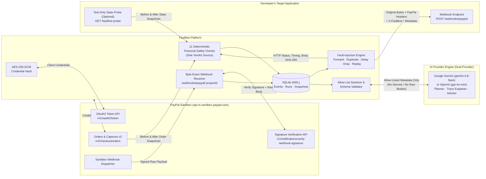

# FAULTLINE

**Payment Reliability & Webhook Chaos Engineering Platform for PayPal Sandbox**

[](https://nodejs.org/)
[](https://developer.paypal.com/api/rest/)
[](https://ai.google.dev/)
[](https://www.npmjs.com/package/openai)
[](https://www.sqlite.org/)
[](#testing--verification)

> *"Don't just test whether your payment works. Test whether it survives failure."*

---

## The Problem

Most developers test payment integrations on the happy path: create an order, approve it in the sandbox, receive one webhook, and verify that the database updates.

In production, payment systems are distributed and asynchronous:
- **Duplicate deliveries**: Payment providers use at-least-once delivery. Network blips or slow acknowledgements trigger automatic retries of the same webhook.
- **Concurrent races**: Two copies of `PAYMENT.CAPTURE.COMPLETED` arriving milliseconds apart can bypass naive `SELECT`-then-`INSERT` checks and credit an account twice.
- **Out-of-order arrival**: A delayed `CHECKOUT.ORDER.APPROVED` webhook arriving *after* `PAYMENT.CAPTURE.COMPLETED` can regress a paid order back to an uncaptured state.
- **Partial transaction failures**: A webhook handler that commits a database write before throwing an HTTP `500` invites a provider retry that double-processes the payment.
- **Dropped notifications**: If a webhook is lost in transit and the application never reconciles against the provider's API, paid orders remain stuck forever.

**Faultline** makes these abnormal delivery conditions testable, observable, and deterministic against real **PayPal Sandbox** transactions, pairing **11 deterministic financial safety checks** with a **strictly guardrailed AI Test Engineer powered by Google Gemini (`gemini-3.8-flash`) or OpenAI (`gpt-4o-mini`)**.

---

## System Architecture



---

## Key Capabilities

### 1. Genuine PayPal Sandbox Integration
- **Live Credential Validation**: Authenticates directly against `https://api-m.sandbox.paypal.com/v1/oauth2/token`. Invalid credentials or unreachable endpoints are reported with PayPal's exact error code and `paypal-debug-id`.
- **End-to-End Sandbox Checkout Flow**: Creates real Sandbox orders (`POST /v2/checkout/orders`), links to PayPal's buyer approval flow, syncs order status (`GET /v2/checkout/orders/{id}`), captures approved payments (`POST /v2/checkout/orders/{id}/capture`), and inspects capture details (`GET /v2/payments/captures/{id}`).
- **Cryptographic Webhook Verification**: Preserves every incoming webhook payload **byte-for-byte** (never re-serialized) and verifies authenticity via PayPal's `POST /v1/notifications/verify-webhook-signature` API. Unverified or forged payloads are never labeled as verified and cannot be forwarded.

### 2. Byte-Exact Webhook Fault Injection (Test Lab)
Select any PayPal-verified webhook event and execute controlled delivery scenarios against your application's webhook endpoint:

| Scenario | What Faultline Does | Failure Mode Tested |
|---|---|---|
| **Forward Once** (`forward`) | Sends the stored verified event once, byte-for-byte. | Baseline webhook signature verification and processing. |
| **Duplicate Delivery** (`duplicate`) | Sends the same verified event **2 to 10 times**, either **sequentially** or **concurrently** (all at once). | Idempotency keys, unique constraints, and race conditions under parallel redelivery. |
| **Delayed Delivery** (`delay`) | Holds the received event and forwards it after a configurable delay (**1 to 3,600 seconds**). | Out-of-order webhook arrival, stale-event state regression, and timestamp tolerance. |
| **Dropped Delivery** (`drop`) | Intentionally withholds the webhook (`0` HTTP requests sent) and records the drop. | Missing-webhook resilience and reconciliation via PayPal's Orders/Captures API. |
| **Replay Delivery** (`replay`) | Resends a previously processed verified event at a later time. | Long-horizon deduplication and protection against duplicate payment creation. |

Every forwarded attempt preserves the original raw JSON bytes and PayPal signature headers (`paypal-transmission-id`, `paypal-transmission-time`, `paypal-transmission-sig`, `paypal-cert-url`, `paypal-auth-algo`) so your application performs its normal signature check, while adding explicit `X-Faultline-*` observability headers:

| Header | Example Value | Purpose |
|---|---|---|
| `X-Faultline-Scenario` | `duplicate` | Active scenario (`forward`, `duplicate`, `delay`, `replay`) |
| `X-Faultline-Delivery-Kind` | `duplicate` | Attempt classification (`original`, `duplicate`, `delayed`, `replay`) |
| `X-Faultline-Attempt` | `2/3` | Attempt index within the scenario run |
| `X-Faultline-Injected` | `true` | `false` only for a baseline single delivery; `true` for fault-injected attempts |
| `X-Faultline-Original-Event-Id` | `WH-2WR32451HC0233532-...` | Original PayPal event ID |
| `X-Faultline-Original-Received-At` | `2026-11-07T14:20:05.112Z` | Timestamp when Faultline first received the event from PayPal |
| `X-Faultline-Run-Id` | `d4f8c9b0-...` | Faultline scenario run UUID |

### 3. Deterministic Financial Safety Invariants (Sole Source of Test Verdicts)
An HTTP `200 OK` response only proves that an HTTP server answered—it does not prove that your application handled the payment safely. Faultline evaluates **11 deterministic checks** (`src/checks.js`) across three explicit evidence sources:
1. **Observed (`observed`)**: Faultline's own HTTP delivery trace, status codes, timings, and SHA-256 payload digests.
2. **PayPal (`paypal`)**: Verified PayPal webhook payloads and PayPal Order/Capture snapshots read before and after the run.
3. **Application State Probe (`probe`)**: An optional test-only `GET` endpoint in your application that Faultline queries before and after each scenario run.

| Deterministic Check | Evidence | Pass Criterion |
|---|---|---|
| **Faultline sent the genuine event unchanged** (`injection_integrity`) | Observed | Every request carried the exact SHA-256 body and PayPal transmission ID of the stored event. |
| **Your endpoint accepted every delivery** (`deliveries_accepted`) | Observed | Every forwarded request received an HTTP `2xx` response. |
| **A failed delivery is not reported as processed** (`failed_delivery_not_processed`) | Probe | When all deliveries fail, `event.processed_count` does not increase. |
| **An accepted delivery was actually processed** (`accepted_delivery_processed`) | Probe | After at least one HTTP `2xx` delivery, `event.processed_count >= 1`. |
| **The same event is processed at most once** (`idempotent_processing`) | Probe | Across duplicate or replayed deliveries, `event.processed_count` never exceeds `1`. |
| **A repeated webhook does not create a second payment record** (`no_second_payment_in_app`) | Probe | `payment.payment_records` never exceeds `1` for the same capture or order. |
| **No new capture appeared at PayPal during the test** (`paypal_payment_unchanged`) | PayPal | Capture count on the linked PayPal Sandbox order did not increase during the webhook test. |
| **Refunds reported by PayPal do not exceed the captured amount** (`refund_events_within_captured`) | PayPal | Verified `PAYMENT.CAPTURE.REFUNDED` events do not sum to more than the captured amount. |
| **Refunds in your application do not exceed the captured amount** (`app_refunds_within_captured`) | Probe | `payment.refunded_amount <= payment.captured_amount`. |
| **A late, older event does not overwrite newer payment state** (`no_stale_overwrite`) | Probe | Delivering an older event after a newer event for the same payment never moves `payment.status` backward. |
| **The payment only makes valid state changes** (`valid_state_transition`) | Probe | `payment.status` stays unchanged or makes a valid PayPal lifecycle transition. |

**Strict Verdict Rules:**
- **Failed**: At least one deterministic check failed.
- **Passed**: Zero checks failed **and** at least one application-state (`probe`) check passed.
- **Inconclusive**: Zero checks failed, but no application-state check could be evaluated (e.g., no state probe configured). HTTP `2xx` replies alone never produce a `Passed` verdict.

---

## AI Provider Disclosure, Safety Boundaries & Privacy Data Flow

Faultline implements a **production-ready Dual-Provider AI Architecture** (`src/ai-provider.js`) powered by:
- **Google Gemini API** via the official **Google Gen AI SDK (`@google/genai`)**, using **`gemini-3.8-flash`** as the default model.
- **OpenAI API** via the official **OpenAI JavaScript SDK (`openai`)**, using **`gpt-4o-mini`** as the alternative model.

### Provider Configuration & Auto-Detection
Configuration is managed cleanly via server-side environment variables in `.env`:
- `AI_PROVIDER`: `auto` (default), `gemini`, or `openai`.
- `GEMINI_API_KEY`: API key for Google Gemini (get one from [Google AI Studio](https://aistudio.google.com/)).
- `GEMINI_MODEL`: Gemini model identifier (default: `gemini-3.8-flash`).
- `OPENAI_API_KEY`: API key for OpenAI (get one from [OpenAI Platform](https://platform.openai.com/api-keys)).
- `OPENAI_MODEL`: OpenAI chat model identifier (default: `gpt-4o-mini`).
- `AI_TIMEOUT_MS`: Request timeout in milliseconds (default: `15000`).

In `auto` mode, Faultline prioritizes Google Gemini if `GEMINI_API_KEY` is present, falling back to OpenAI if `OPENAI_API_KEY` is configured.

### Honest AI Labeling & Graceful Degradation
- **No Fake AI**: Rule-based or deterministic logic is never labeled as AI. Coverage-gap checks loaded via `GET /api/projects/:id/ai/suggestions` are explicitly labeled `source: "deterministic_coverage"`.
- **Works Without an AI Key**: If neither `GEMINI_API_KEY` nor `OPENAI_API_KEY` is configured, Faultline starts normally. All PayPal Sandbox, webhook verification, Test Lab fault-injection, and deterministic checks function in full. `GET /api/projects/:id/ai/status` reports `configured: false`, the UI displays a clear setup banner explaining how to configure your AI provider, and AI endpoints return `503 ai_not_configured`.

### How AI Is Used
1. **Plain-English Test Planning (`POST /api/projects/:id/ai/plans`)**: Interprets a developer's natural-language testing goal and proposes a structured JSON plan using only Faultline's 5 supported scenarios (`forward`, `duplicate`, `delay`, `drop`, `replay`) and 11 deterministic checks (`KNOWN_CHECKS`).
2. **Evidence-Based Run Explanation (`POST /api/projects/:id/scenario-runs/:runId/analyze`)**: Analyzes sanitized execution traces from completed runs to explain what was expected, where the failure occurred, why it matters in production, what to investigate, and concrete remediation steps.
3. **Follow-Up Test Recommendations (`POST /api/projects/:id/ai/suggestions`)**: Reviews sanitized metadata of stored verified events, past scenario runs, and failed checks to suggest high-priority follow-up tests.

### Non-Negotiable Safety Boundaries
- **Deterministic Verdicts Only**: Deterministic checks in `src/checks.js` are the **sole** source of test verdicts. `buildAnalysisFromModelOutput` and `enforceAnalysisGuardrails` reject any model output that attempts to alter or override a verdict and lock `deterministicVerdict.canOverride = false`.
- **User Confirmation Required**: Generating a test plan never executes a scenario automatically. Execution requires explicit user confirmation (`POST /api/projects/:id/ai/plans/:planId/execute`), which re-validates the stored specification with `validateTestSpec` before sending a single webhook.
- **Zero Financial Authority**: The model has no access to PayPal APIs and can never create orders, capture payments, or issue refunds (`financialOperationsAllowed: false` is enforced on every specification).
- **Strict Schema Validation**: Every model response must pass `buildPlanFromModelOutput`, `buildAnalysisFromModelOutput`, or `buildSuggestionsFromModelOutput`. Any unknown scenario kind, out-of-range parameter, hallucinated check ID, or reference to an unverified event is rejected with `502 ai_invalid_output` and never saved.
- **Rate, Timeout & Size Protections**: Bounded prompt/context input (`<= 500` char prompt, `<= 16 KB` payload), bounded completion tokens (`maxOutputTokens` / `max_completion_tokens: 1200`), per-request `AbortController` timeouts (`AI_TIMEOUT_MS`), and per-project rate limiting (`20` requests/min).

### Privacy & Data Minimization (`src/ai-engineer.js`)
Prompts and event-derived strings are treated as untrusted input wrapped in delimiter tags and scrubbed by `redactSensitiveText`.

| Sent to AI Provider (Allow-Listed Metadata Only) | Never Sent to AI Provider (Remains Local on Faultline Server) |
|---|---|
| Verified event `id`, `paypalEventId`, `eventType`, `resourceType`, `paypalEventCreatedAt`, `processingStatus` | PayPal `clientId`, encrypted/decrypted `clientSecret`, OAuth access tokens |
| Scenario `kind`, `params` (`count`, `mode`, `delaySeconds`), `status`, `verdict`, `verdictReason` | `ENCRYPTION_KEY`, `SESSION_SECRET`, `ADMIN_PASSWORD`, session cookies |
| Delivery attempt `attemptNo`, `deliveryKind`, `outcome`, `httpStatus`, `durationMs` | Raw webhook bodies (`raw_body`), PayPal signature headers (`headers_json`), `resource_id`, buyer PII/emails |
| State probe numeric/status fields (`processedCount`, `status`, `paymentRecords`, `capturedCents`, `refundedCents`) and assertion `id`, `verdict`, `summary` | Target application URLs (`webhookEndpointUrl`, `probeUrl`) and raw HTTP response snippets (`response_snippet`) |

---

## Quickstart & Local Setup

### Prerequisites
- **Node.js 22 LTS** (Node.js `>=20` supported)
- A free [PayPal Developer](https://developer.paypal.com) account (for live Sandbox calls)
- Optional: A [Google AI Studio API key](https://aistudio.google.com/) (`GEMINI_API_KEY`) or [OpenAI API key](https://platform.openai.com/api-keys) (`OPENAI_API_KEY`)

### 1. Install & Initialize
```cmd
git clone https://github.com/NOBA235/faultline.git
cd faultline
npm.cmd install
npm.cmd run setup
```
- `npm.cmd run setup` creates `.env` from `.env.example` with freshly generated random `ENCRYPTION_KEY`, `SESSION_SECRET`, and `ADMIN_PASSWORD` values (and never overwrites an existing `.env`).
- Optional: Open `.env` and configure `GEMINI_API_KEY=AIzaSy...` (or `OPENAI_API_KEY=sk-...`).
- Start the server:
  ```cmd
  npm.cmd start
  ```
- Open **http://127.0.0.1:3000** and sign in with the `ADMIN_PASSWORD` printed during setup.

### 2. Run the Interactive Fault-Injection Demo
Faultline ships with a standalone demo receiver and state probe (`scripts/demo-receiver.js`) that can run in **`buggy`** mode (non-idempotent, vulnerable to duplicate processing and stale overwrites) or **`idempotent`** mode (properly guarded):

1. **Start the demo receiver in `buggy` mode** (in a second terminal):
   ```cmd
   node scripts\demo-receiver.js buggy
   ```
   *(Listens on `http://127.0.0.1:4000`)*
2. **Create a Project in Faultline**:
   - **Sandbox Client ID & Secret**: From your [PayPal Developer Dashboard](https://developer.paypal.com/dashboard/applications/sandbox)
   - **Webhook Endpoint URL**: `http://127.0.0.1:4000/webhooks/paypal`
   - **State Probe URL**: `http://127.0.0.1:4000/faultline-probe`
3. **Receive a Verified PayPal Webhook**:
   - Expose port `3000` via an HTTPS tunnel (e.g., `ngrok http 3000`), set `PUBLIC_BASE_URL=https://<your-tunnel>` in `.env`, register the project's **Receiver URL** in your PayPal Sandbox App's Webhooks settings, save the **PayPal Webhook ID** in Faultline, and create/approve/capture a Sandbox order.
4. **Watch Faultline Catch the Bug**:
   - In **Test Lab** (or via **AI Test Engineer** when an AI key is configured), run **Duplicate delivery (`count: 2`, `sequential`)** on the verified `PAYMENT.CAPTURE.COMPLETED` event.
   - **Result**: Faultline marks the run **Failed**—showing that although your endpoint returned `HTTP 200` on both deliveries, `event.processed_count` and `payment.payment_records` both climbed to `2`.
5. **Verify the Fix**:
   - Restart the demo receiver in `idempotent` mode:
     ```cmd
     node scripts\demo-receiver.js idempotent
     ```
   - Re-run the duplicate delivery scenario and watch all deterministic application-state checks **Pass**.

---

## Manual Acceptance Checklist (Live PayPal Sandbox End-to-End Verification)

Automated tests in `test/` use local fixture servers (`support/fixtures.js`) and injected mock AI clients (`createMockGeminiClient` & `createMockOpenAIClient`) so they run offline without credentials. Before production or hackathon demonstration, verify the live end-to-end flow with your real PayPal Sandbox credentials using this checklist:

- [ ] **1. Live Sandbox OAuth2 Connection**: Create a project in Faultline with your PayPal Sandbox `Client ID` and `Secret`. Confirm the project badge shows **Connected to PayPal Sandbox** (`POST https://api-m.sandbox.paypal.com/v1/oauth2/token` returns HTTP `200`).
- [ ] **2. Sandbox Order Creation**: In the **Sandbox Orders** tab, create a `$10.00 USD` order. Confirm Faultline displays the real PayPal Order ID (`PAYER_ACTION_REQUIRED`) and logs the `create_order` call with a `paypal-debug-id`.
- [ ] **3. Buyer Approval in PayPal Sandbox**: Click **Approve in PayPal Sandbox**, sign in with a PayPal Sandbox personal (buyer) account, complete approval, return to Faultline, and click **Refresh from PayPal** to confirm status is `APPROVED`.
- [ ] **4. Order Capture**: Click **Capture payment**. Confirm PayPal transitions the order to `COMPLETED` and Faultline records the PayPal Capture ID (`COMPLETED`).
- [ ] **5. Public HTTPS Webhook Delivery**: Run an HTTPS tunnel (`ngrok http 3000` or `cloudflared tunnel --url http://127.0.0.1:3000`), set `PUBLIC_BASE_URL` in `.env`, register `https://<tunnel>/webhooks/paypal/<projectId>` in the PayPal Developer Dashboard, and save the **PayPal Webhook ID** in Faultline.
- [ ] **6. Cryptographic Signature Verification**: Confirm incoming `CHECKOUT.ORDER.APPROVED` and `PAYMENT.CAPTURE.COMPLETED` events appear in **Event Explorer** with badge **Verified by PayPal** (`POST /v1/notifications/verify-webhook-signature` returned `SUCCESS`).
- [ ] **7. Fault-Injection & Deterministic Verdict**: Run **Duplicate delivery (`x3`)** against `scripts/demo-receiver.js buggy` and confirm verdict is **Failed** (`idempotent_processing` and `no_second_payment_in_app` fail). Switch receiver to `idempotent` mode, re-run, and confirm verdict is **Passed**.
- [ ] **8. AI Test Planning & Trace Explanation**: With `GEMINI_API_KEY` (or `OPENAI_API_KEY`) set in `.env`, generate a plain-English test plan in **AI Test Engineer**, confirm & execute it against the verified event, and click **Explain run from evidence** to verify the schema-validated explanation and locked deterministic verdict.
- [ ] **4. Order Capture**: Click **Capture payment**. Confirm PayPal transitions the order to `COMPLETED` and Faultline records the PayPal Capture ID (`COMPLETED`).
- [ ] **5. Public HTTPS Webhook Delivery**: Run an HTTPS tunnel (`ngrok http 3000` or `cloudflared tunnel --url http://127.0.0.1:3000`), set `PUBLIC_BASE_URL` in `.env`, register `https://<tunnel>/webhooks/paypal/<projectId>` in the PayPal Developer Dashboard, and save the **PayPal Webhook ID** in Faultline.
- [ ] **6. Cryptographic Signature Verification**: Confirm incoming `CHECKOUT.ORDER.APPROVED` and `PAYMENT.CAPTURE.COMPLETED` events appear in **Event Explorer** with badge **Verified by PayPal** (`POST /v1/notifications/verify-webhook-signature` returned `SUCCESS`).
- [ ] **7. Fault-Injection & Deterministic Verdict**: Run **Duplicate delivery (`x3`)** against `scripts/demo-receiver.js buggy` and confirm verdict is **Failed** (`idempotent_processing` and `no_second_payment_in_app` fail). Switch receiver to `idempotent` mode, re-run, and confirm verdict is **Passed**.
- [ ] **8. OpenAI Test Planning & Trace Explanation**: With `OPENAI_API_KEY` set in `.env`, generate a plain-English test plan in **AI Test Engineer**, confirm & execute it against the verified event, and click **Explain run from evidence (OpenAI)** to verify the schema-validated explanation and locked deterministic verdict.

---

## Application State Probe Contract

To let Faultline verify internal financial invariants without coupling to your database engine, expose a test-only `GET` endpoint in your staging/test environment:

```http
GET <probe_url>?event_id=WH-...&resource_id=...&event_type=PAYMENT.CAPTURE.COMPLETED
```

```json
{
  "event": {
    "processed_count": 1
  },
  "payment": {
    "status": "COMPLETED",
    "captured_amount": "10.10",
    "refunded_amount": "0.00",
    "currency": "USD",
    "payment_records": 1
  }
}
```

---

## Testing & Verification

Run the full automated test suite (**141 tests** across 13 test files):

```cmd
node --test
```

| Test Suite | Coverage |
|---|---|
| `test/paypal.test.js` & `test/orders.test.js` | OAuth2 token exchange, Order creation/refresh/capture, idempotency locks, and error handling |
| `test/webhooks.test.js` | Byte-exact webhook ingestion, PayPal signature verification states, redelivery deduplication, and forgery rejection |
| `test/scenarios.test.js` | Baseline forwarding, sequential & concurrent duplicates, delayed delivery timers, deliberate drops, and replays |
| `test/checks.test.js` & `test/checks-integration.test.js` | All 11 deterministic financial safety checks against idempotent and planted-bug target applications |
| `test/ai-engineer.test.js` & `test/ai-integration.test.js` | Injected Google Gemini and OpenAI provider mocks, dual-provider auto-detection, missing key handling (`503`), invalid model outputs (`502`), timeouts (`504`), rate limits (`429`), prompt injection defense (`422`), secret/data minimization proof, and proof that AI output never alters deterministic verdicts or initiates financial operations |
| `test/reports.test.js` | Overview metrics accuracy, reliability findings, failed assertions, and Markdown/JSON report exports |
| `test/api.test.js`, `test/crypto.test.js`, `test/config.test.js`, `test/db.test.js` | Authentication, AES-256-GCM tamper detection, configuration validation (including `GEMINI_*` and `OPENAI_*`), and SQLite schema migrations |

### Statement on Fixture-Tested vs. Manually Verified Behavior
- **Automated Fixture Tests (`[fixture]`)**: All 141 automated tests run offline against local HTTP stand-in servers (`support/fixtures.js`) and injected mock AI clients (`createMockGeminiClient` and `createMockOpenAIClient`). They do not require live API keys or PayPal Sandbox credentials and never claim to be live PayPal end-to-end tests.
- **Manual Sandbox & AI Verification**: Live PayPal Sandbox OAuth, order creation, buyer approval, capture, public HTTPS webhook delivery, PayPal cryptographic signature verification, and live AI completions require user-supplied credentials in `.env` and are verified using the [Manual Acceptance Checklist](#manual-acceptance-checklist-live-paypal-sandbox-end-to-end-verification) above.

---

## Environment Variables

Copy `.env.example` to `.env` (or run `npm.cmd run setup`). Never commit `.env`.

| Variable | Required | Default | Description |
|---|---|---|---|
| `ENCRYPTION_KEY` | Yes | — | 64 hex characters (32 bytes). Master key for AES-256-GCM encryption of PayPal secrets. |
| `SESSION_SECRET` | Yes | — | At least 32 characters. Signs the `HttpOnly` session cookie. |
| `ADMIN_PASSWORD` | Yes | — | At least 12 characters. Password for signing in to the Faultline UI. |
| `AI_PROVIDER` | No | `auto` | Active AI provider (`auto`, `gemini`, or `openai`). In `auto` mode, Gemini takes priority if `GEMINI_API_KEY` is present. |
| `GEMINI_API_KEY` | No | — | Server-side Google Gemini API key from [Google AI Studio](https://aistudio.google.com/). |
| `GEMINI_MODEL` | No | `gemini-3.8-flash` | Gemini model identifier (`^[A-Za-z0-9._:-]{1,100}$`). |
| `OPENAI_API_KEY` | No | — | Server-side OpenAI API key from [OpenAI Platform](https://platform.openai.com/api-keys). |
| `OPENAI_MODEL` | No | `gpt-4o-mini` | OpenAI chat model identifier (`^[A-Za-z0-9._:-]{1,100}$`). |
| `AI_TIMEOUT_MS` | No | `15000` | Timeout (ms) for AI model requests (`1000`–`60000`). |
| `PORT` | No | `3000` | HTTP server port (`1`–`65535`). |
| `HOST` | No | `127.0.0.1` | Bind address. |
| `DATABASE_PATH` | No | `data/faultline.db` | Path to the SQLite database file. |
| `PUBLIC_BASE_URL` | No | `http://HOST:PORT` | Public base URL used for PayPal return links and displayed webhook receiver URLs. |
| `PAYPAL_TIMEOUT_MS` | No | `10000` | Timeout (ms) for requests to PayPal Sandbox (`1000`–`60000`). |
| `FORWARD_TIMEOUT_MS` | No | `10000` | Timeout (ms) when forwarding webhooks or querying the state probe (`1000`–`60000`). |
| `PROBE_SETTLE_MS` | No | `500` | Wait time (ms) after the final delivery attempt before reading the post-run state probe (`0`–`10000`). |
| `COOKIE_SECURE` | No | `false` | Set to `true` when serving Faultline over HTTPS. |

---

## Hackathon Submission Guide (“Build What’s Next with PayPal and AI”)

Use the following reference when completing your hackathon submission form:

1. **Project Description**:
   - *Faultline* is a payment reliability and webhook chaos-engineering platform for **PayPal Sandbox**. It captures genuine, cryptographically verified PayPal Sandbox webhooks and tests whether a developer's payment integration survives duplicate deliveries (sequential and concurrent), delayed out-of-order arrivals, dropped notifications, and replays—evaluating 11 deterministic financial safety invariants across HTTP traces, PayPal Order/Capture snapshots, and an application state probe.
2. **AI Tool / Model & How It Is Used**:
   - Implements a **Dual-Provider Architecture** supporting **Google Gemini API** (`gemini-3.8-flash` via `@google/genai`) as primary and **OpenAI** (`gpt-4o-mini` via `openai`) as alternative/fallback.
   - **Plain-English Test Planner**: Translates natural-language reliability goals into schema-validated Faultline test specifications (`buildPlanFromModelOutput` + `validateTestSpec`), gated behind explicit user confirmation.
   - **Evidence-Based Run Analyzer**: Explains completed or failed scenario runs from allow-listed, sanitized execution traces (`sanitizeTraceForAi` + `buildAnalysisFromModelOutput`) while locking the deterministic verdict (`canOverride: false`).
   - **Follow-Up Test Advisor**: Recommends concrete next fault scenarios from stored verified events and failed checks (`sanitizeEvidenceForAi` + `buildSuggestionsFromModelOutput`).
3. **Working Demo**:
   - Run `npm.cmd start` and `node scripts\demo-receiver.js buggy`, connect your PayPal Sandbox app, capture a Sandbox order, and run a Duplicate Delivery test plan to show Faultline catching a double-credit bug (`HTTP 200` returned twice, `payment_records` incremented to `2`), then switch to `node scripts\demo-receiver.js idempotent` to show the fix passing all deterministic checks.
4. **Public Repository Access & Secret Hygiene**:
   - Repository URL: `https://github.com/NOBA235/faultline` (ensure repository visibility is set to **Public**).
   - `.env` and `data/*.db` are ignored in `.gitignore`; only placeholder variable names exist in `.env.example`.
5. **Demo Video Outline (2–3 Minutes)**:
   - **0:00–0:30**: Problem statement—why `HTTP 200` on a happy-path payment does not prove webhook reliability.
   - **0:30–1:15**: Create and capture a real PayPal Sandbox order in Faultline; inspect the incoming `PAYMENT.CAPTURE.COMPLETED` webhook verified via PayPal's signature verification API.
   - **1:15–2:00**: Ask the AI Test Engineer (powered by Google Gemini 3.8 Flash) in plain English to test duplicate webhook delivery; review the schema-validated specification, confirm execution against `demo-receiver.js buggy`, and show the **Failed** deterministic verdict catching duplicate payment creation.
   - **2:00–2:30**: Click **Explain run from evidence** to show the root-cause analysis and locked verdict, then re-run against `demo-receiver.js idempotent` to show all 11 deterministic checks passing.

---

## Repository Structure

```text
faultline/
├── src/
│   ├── server.js          # HTTP server entrypoint & graceful shutdown
│   ├── app.js             # Express application, auth, CSP, and project routes
│   ├── paypal.js          # PayPal Sandbox REST API client (OAuth2, Orders, Captures, Verify)
│   ├── paypal-service.js  # Token caching, 401 retry, and API call logging
│   ├── orders.js          # Sandbox order creation, refresh, and capture routes
│   ├── webhooks.js        # Raw-byte webhook receiver, signature verification, and explorer API
│   ├── forwarder.js       # Fault-injection execution engine (forward, duplicate, delay, drop, replay)
│   ├── scenarios.js       # Scenario validation and run inspection routes
│   ├── checks.js          # 11 deterministic financial safety invariant checks (sole verdict source)
│   ├── probe.js           # Application state probe client & response normalizer
│   ├── evidence.js        # Pre/post-run probe and PayPal order snapshot collector
│   ├── ai-provider.js     # Google Gemini & OpenAI dual-provider service with timeouts & safe error mapping
│   ├── ai-engineer.js     # Allow-list sanitizers, strict model schema validators & guardrails
│   ├── ai.js              # AI Test Engineer REST endpoints & rate limiting
│   ├── reports.js         # Overview metrics, findings, failed assertions & Markdown/JSON exports
│   ├── crypto.js          # AES-256-GCM cipher, HMAC token signing & constant-time compare
│   ├── db.js              # SQLite connection & schema migrations
│   └── config.js          # Environment variable validation
├── public/
│   ├── index.html         # Single-Page developer workbench shell
│   ├── app.js             # Zero-dependency frontend UI with dynamic provider switching
│   ├── app.css            # Dark-mode observability dashboard stylesheet
│   ├── faultline-mark.svg # Custom Faultline brand mark
│   └── paypal-return.html # Buyer approval return landing page
├── scripts/
│   ├── setup-env.js       # Generates .env with random cryptographic keys
│   └── demo-receiver.js   # Standalone demo webhook receiver & state probe (buggy / idempotent)
├── support/
│   └── fixtures.js        # Controllable PayPal Sandbox, target app & offline Gemini/OpenAI mocks
└── test/                  # 141 automated unit and integration tests
```
